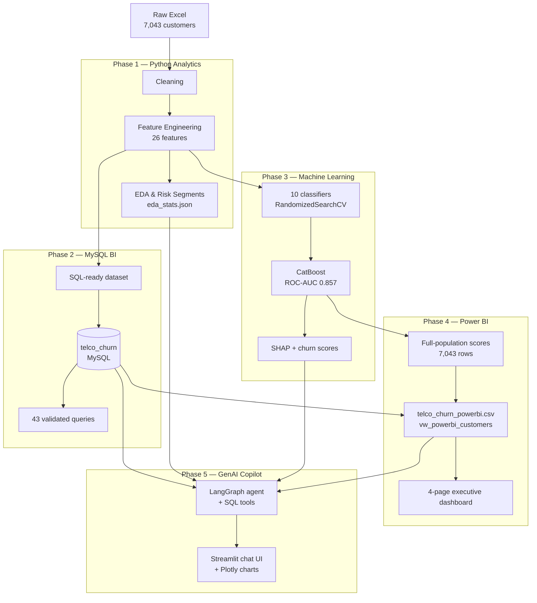
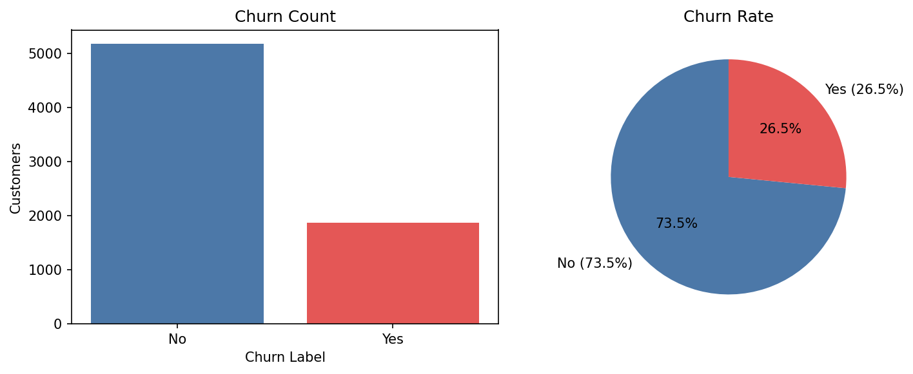
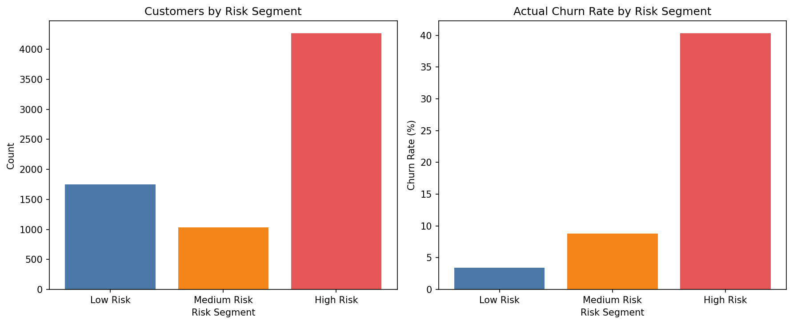
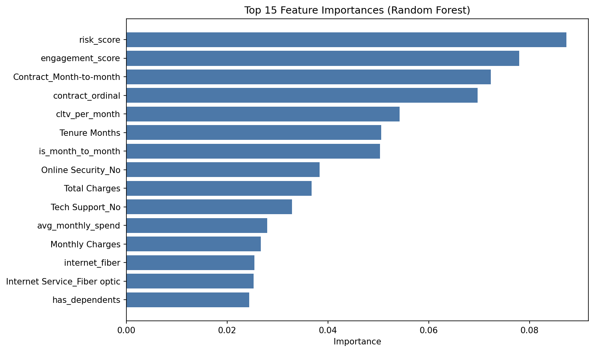
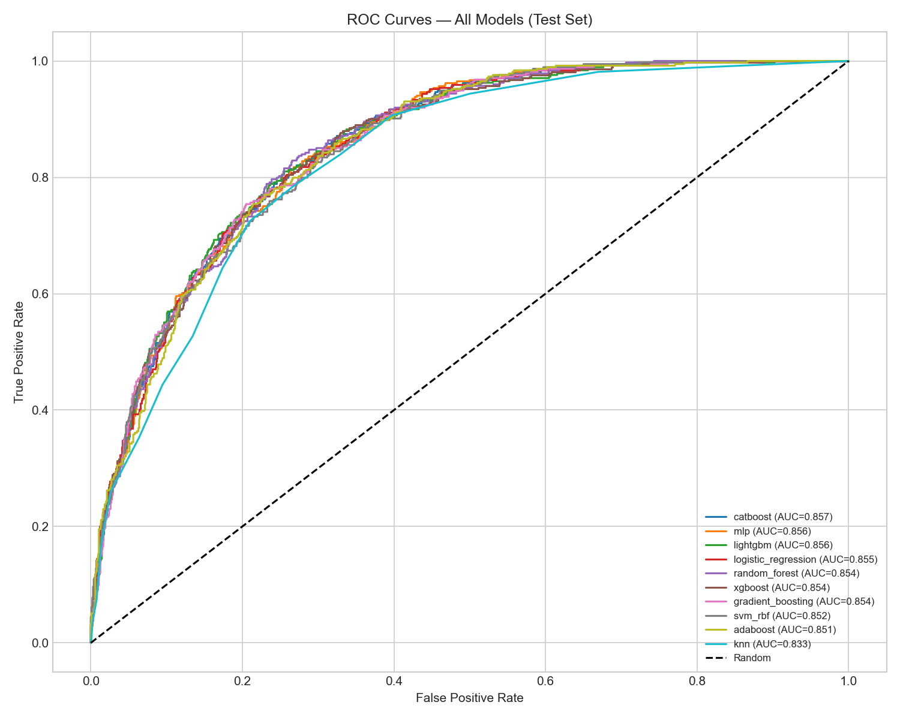
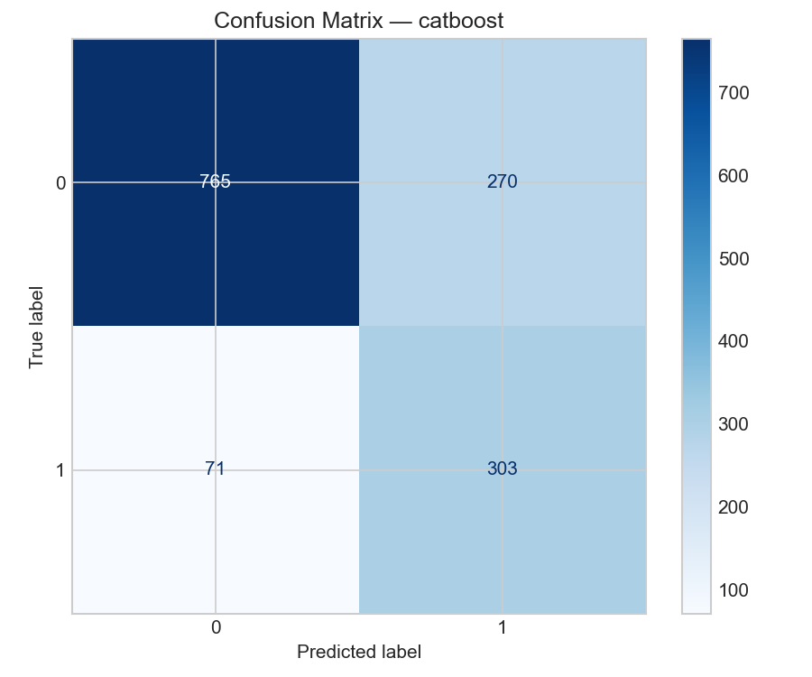
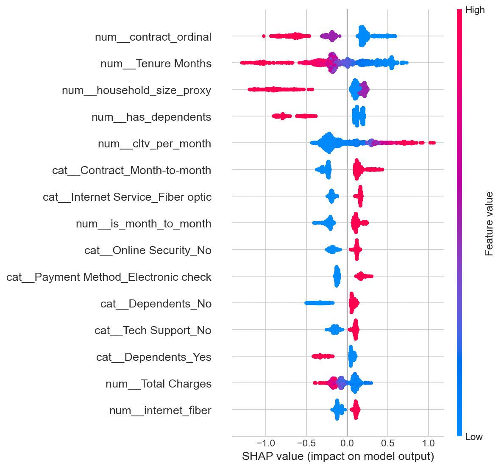
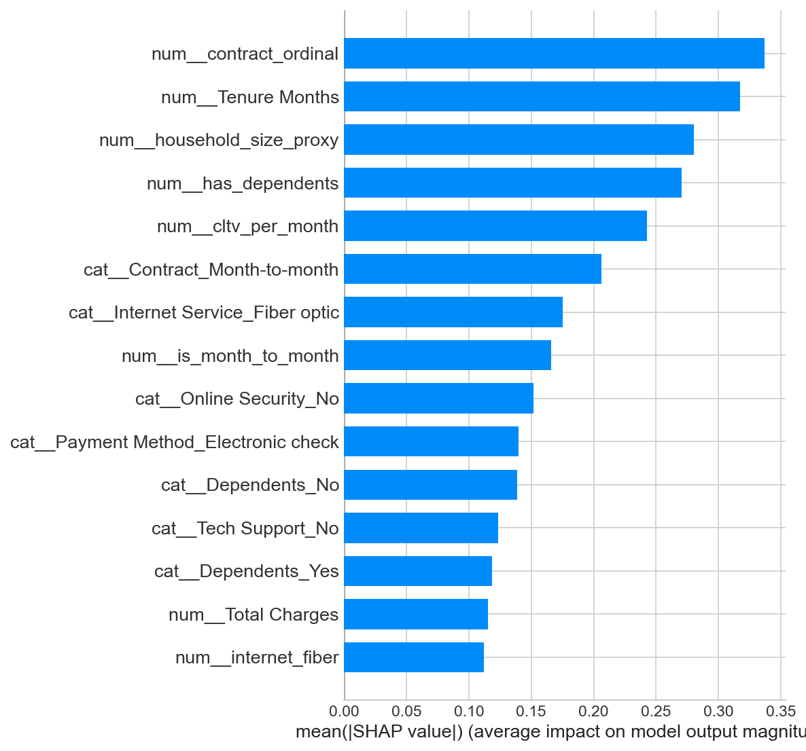

# Customer Churn Analysis for Telco Subscribers: A Data-Driven Research Report

**Project:** Customer Churn Prediction & Analytics Dashboard  
**Dataset:** IBM Telco Customer Churn (7,043 records)  
**Period:** June 2026  
**Stack:** Python, MySQL 8.0, scikit-learn, CatBoost, SHAP, Power BI, Streamlit, LangGraph  

---

## Abstract

This study presents an end-to-end Telco churn analytics pipeline across five phases: Python preprocessing and EDA, MySQL business intelligence, supervised machine learning, Power BI executive reporting, and a GenAI Streamlit copilot. On 7,043 subscribers, the overall churn rate is 26.54%. Month-to-month contracts (42.71%) and fiber optic users (41.89%) show the highest attrition. Ten classifiers were tuned for ROC-AUC; CatBoost achieved the best test score of **0.857**. SHAP analysis confirms contract type and tenure as leading predictors. Insights are operationalized in MySQL, visualized in Power BI, and exposed via natural-language Q&A grounded in live data.

**Keywords:** Customer churn, Telco, feature engineering, CatBoost, SHAP, MySQL, Power BI, GenAI

---

## 1. Introduction

### 1.1 Background

Telecommunications providers face high acquisition costs and competitive pressure. Churn reduces recurring revenue and increases retention spend. Descriptive and predictive analytics help identify at-risk customers and target interventions.

### 1.2 Objectives

1. Prepare and engineer features from a real-world Telco churn dataset.
2. Uncover churn drivers through EDA and SQL-based reporting.
3. Train and compare supervised classifiers with explainability.
4. Deliver executive dashboards and a natural-language analytics interface.

### 1.3 Scope

Phases 1–5 cover the full analytics lifecycle: data analysis (Python), operational BI (MySQL), predictive modeling (ML), visualization (Power BI), and conversational access (GenAI copilot).

---

## 2. Related Work

Churn analytics typically combines segment-level descriptive metrics (ARPU, CLTV, cohort trends), engineered behavioral features, and gradient-boosted or ensemble classifiers. Enterprise deployments often pair Python pipelines with SQL reporting layers. This project follows that hybrid pattern and extends it with ML scoring, dashboard delivery, and LLM-assisted querying.

---

## 3. Dataset

| Attribute | Detail |
|-----------|--------|
| Source | `Telco_customer_churn.xlsx` |
| Records | 7,043 customers |
| Features | 33 original → 59 after engineering |
| Target | `Churn Value` (0/1), 26.54% positive class |
| Geography | United States (California-heavy sample) |

**Data quality:** 11 `Total Charges` whitespace values (tenure = 0) set to 0.0; missing churn reasons for retained customers imputed as "Not Applicable"; calendar dates derived in Phase 2 for time-series SQL.

---

## 4. System Architecture

End-to-end flow tying Phases 1–5:

---

## 5. Methodology

### 5.1 Phase 1 — Python Pipeline

| Step | Output | Summary |
|------|--------|---------|
| Cleaning | `Telco_customer_churn_cleaned.csv` | Duplicates checked; numeric fixes; churn-reason imputation |
| Feature engineering | `Telco_customer_churn_engineered.csv` | 26 features: tenure groups, contract flags, service counts, engagement/risk scores |
| EDA | `eda_outputs/` | Churn breakdowns, correlation, Random Forest importance, risk segmentation |

### 5.2 Phase 2 — MySQL Layer

Prepared `telco_customers_sql_ready.csv` (68 columns) with derived join/churn dates, risk segments, and snake_case naming. Loaded into `telco_churn.telco_customers`; 43 queries validated for churn, ARPU, CLTV, cohorts, and window analytics.

### 5.3 Phase 3 — Machine Learning

- **Split:** 80/20 stratified (5,634 train / 1,409 test)
- **Preprocessor:** imputation + scaling (numeric); imputation + one-hot encoding (categorical)
- **Models:** Logistic Regression, Random Forest, Gradient Boosting, AdaBoost, SVM, KNN, MLP, XGBoost, LightGBM, CatBoost
- **Tuning:** `RandomizedSearchCV`, ROC-AUC, 5-fold CV; class imbalance handled per algorithm
- **Outputs:** `ml_outputs/churn_predictions.csv`, SHAP plots, `phase3_summary.json`

### 5.4 Phase 4 — Power BI

CatBoost scores applied to all 7,043 customers; unified dataset (`powerbi/telco_churn_powerbi.csv`) and MySQL view `vw_powerbi_customers` feed a 4-page dashboard (executive summary, churn analysis, revenue, customer behavior) with slicers, drill-down, KPI cards, and Top 10 at-risk table.

### 5.5 Phase 5 — GenAI Copilot

Streamlit UI (`streamlit/churn_copilot.py`) calls a LangGraph agent (`genai/copilot.py`) with tools for read-only SQL, segment summaries, trends, top-risk customers, and Plotly charts. Context from `eda_stats.json` and `phase3_summary.json` grounds LLM responses in project data.

---

## 6. Results

Key findings below are supported by figures generated from the Phase 1 EDA pipeline (`eda_analysis.py`) and Phase 3 evaluation notebooks (`notebooks/03_evaluation_shap.ipynb`).

### 6.1 Churn Profile and Segments

| Metric | Value |
|--------|-------|
| Overall churn rate | **26.54%** |
| Month-to-month contract | **42.71%** |
| Two-year contract | 2.83% |
| Fiber optic | **41.89%** |
| New customers (0–12 mo) | **47.44%** |
| Electronic check payment | **45.29%** |
| ARPU (churned vs retained) | $74.44 vs $61.27 |

| Risk segment | Share | Actual churn rate |
|--------------|-------|-------------------|
| Low | 25% | 3.43% |
| Medium | 15% | 8.83% |
| High | 60% | 40.29% |

*Figure 1. Distribution of retained vs churned customers (n = 7,043). Churned subscribers account for 26.54% of the base.*

*Figure 2. Customer counts and actual churn rates by rule-based risk segment (Low / Medium / High). High-risk customers drive the majority of churn events.*

*Figure 3. Random Forest feature importance (Phase 1 EDA). Contract type, tenure, engagement/risk scores, and CLTV-related features rank highest.*

### 6.2 Model Performance (Test Set)

| Model | Accuracy | Precision | Recall | F1 | ROC-AUC |
|-------|----------|-----------|--------|-----|---------|
| **CatBoost** | 0.758 | 0.529 | 0.810 | 0.640 | **0.857** |
| LightGBM | 0.762 | 0.534 | 0.808 | 0.643 | 0.856 |
| MLP | 0.805 | 0.654 | 0.562 | 0.604 | 0.856 |
| Logistic Regression | 0.752 | 0.522 | 0.808 | 0.634 | 0.855 |
| XGBoost | 0.759 | 0.531 | 0.783 | 0.633 | 0.854 |
| KNN | 0.776 | 0.586 | 0.527 | 0.555 | 0.833 |

**Best model:** CatBoost (ROC-AUC = 0.857, Recall = 0.810).

*Figure 4. ROC curves on the held-out test set (1,409 customers). CatBoost, LightGBM, and MLP cluster near the top; KNN trails on discriminative power.*

*Figure 5. Confusion matrix for CatBoost. The model favors recall (0.810), suitable for flagging at-risk customers for retention outreach.*

### 6.3 SHAP Drivers (CatBoost)

| Feature | Mean \|SHAP\| |
|---------|---------------|
| contract_ordinal | 0.337 |
| Tenure Months | 0.318 |
| household_size_proxy | 0.280 |
| has_dependents | 0.271 |
| cltv_per_month | 0.243 |
| Internet Service (Fiber optic) | 0.175 |
| Payment Method (Electronic check) | 0.140 |

*Figure 6. SHAP summary plot: feature impact on churn prediction. Red = higher feature value; contract length and tenure dominate.*

*Figure 7. Mean |SHAP| bar chart for the top CatBoost drivers, aligning with EDA findings on contract, tenure, and household attributes.*

### 6.4 Deployment Outputs

| Phase | Key artifact |
|-------|----------------|
| Power BI | `powerbi/telco_churn_powerbi.csv`, DAX measures, build guide |
| GenAI | `streamlit/churn_copilot.py`, `genai/copilot.py` |

Full-population risk tiers (CatBoost): Low &lt; 40% (3,711), Medium 40–70% (1,579), High ≥ 70% (1,753).

## 7. Discussion

### 7.1 Business Insights

1. **Contract length** is the strongest lever — month-to-month subscribers churn at ~15× the rate of two-year holders.
2. **First-year retention** is critical — nearly half of new customers churn within 12 months.
3. **Fiber paradox** — premium fiber users churn heavily, likely reflecting competition and price sensitivity.
4. **Payment behavior** — auto-pay correlates with lower churn; electronic check users are highest risk.
5. **Predictive scoring** — CatBoost and rule-based risk segments both separate low- vs high-churn populations effectively.

### 7.2 Limitations

- Join/churn dates are derived, not actual billing timestamps.
- Rule-based risk scores are heuristic, not calibrated probabilities.
- Geographic concentration (California) limits generalizability.
- Associations reported are not causal.

### 7.3 Recommendations

| Priority | Action | Target |
|----------|--------|--------|
| High | Contract upgrade incentives | Month-to-month, tenure &lt; 12 mo |
| High | Fiber retention outreach | Fiber + high monthly charges |
| Medium | Auto-pay enrollment | Electronic check users |
| Medium | Security/tech-support bundles | Low add-on count |
| Low | Loyalty rewards | Two-year, tenure &gt; 36 mo |

---

## 8. Conclusion

This report documents a five-phase Telco churn framework: Python EDA and feature engineering revealed contract type, tenure, internet service, and payment method as primary drivers; MySQL operationalized 43 reproducible queries; CatBoost achieved ROC-AUC **0.857** with SHAP-confirmed drivers; Power BI delivers executive monitoring; and the GenAI copilot enables grounded natural-language analytics. The pipeline from raw data to scored, visualized, and conversational insights is reproducible and applicable to telecom CRM use cases.

**Future work:** FastAPI batch scoring API, RAG over project documentation, and precision–recall threshold tuning for retention campaigns.

---

## 9. References

1. IBM Telco Customer Churn Dataset — benchmark for churn analytics.
2. Chen, D., & Sakurai, S. (2019). *Data Mining for Business Analytics*.
3. MySQL 8.0 Reference Manual — window functions.
4. Breiman, L. (2001). Random Forests. *Machine Learning*, 45(1), 5–32.
5. Lundberg, S. M., & Lee, S.-I. (2017). SHAP. *NeurIPS*.
6. Chen, T., & Guestrin, C. (2016). XGBoost. *KDD*.

---

*For setup and reproduction, see `sql/README.md`, `genai/README.md`, and `powerbi/DASHBOARD_BUILD_GUIDE.md`.*
